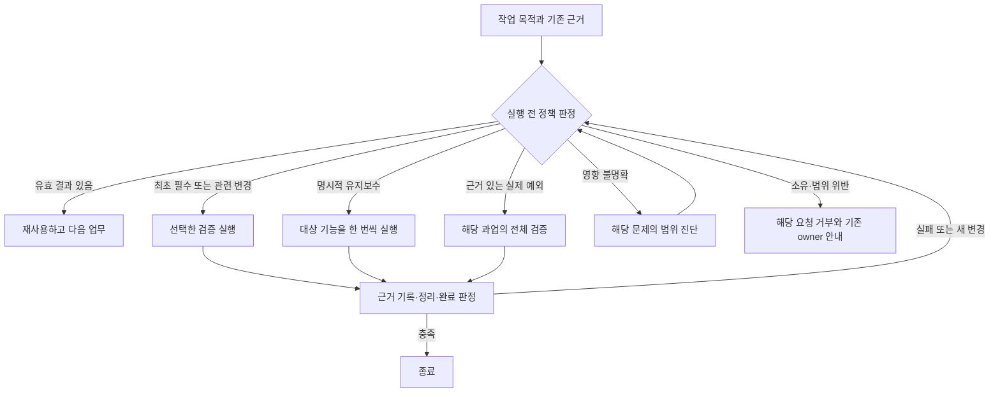

# 검증 트리거와 재검증 제어 설계

> **SUPERSEDED-IN-PART:** [노드 간 검수 범위 정정](harness_26102916_노드간_검수_범위_정정.md). 참고자료를 노드 간 검수의 새 운영체계로 확대해 제안한 세 가지 모드·기능 맵·범용 코드 통합·완료 기준은 이번 개정의 채택 대상에서 철회한다. 자료 내용에 대한 분석과 기존 합의 요약은 보존한다. 확대 설계는 인터뷰에서 승인되지 않았다.

작성일: 2026-10-29 KST. 상태: 자료 분석에 근거한 설계 제안. 헌장·스킬·실행 코드의 개정이나 외부 스킬 설치를 완료한 문서가 아니다.

## 1. 결론과 설계 범위

**검증할 이유와 범위는 create/maintain 자료에서 정하고, 실행과 근거의 상태 관리는 unlazy에서 선별적으로 가져온다.** 그 위에 이미 합의한 아스트라 작업 원칙을 적용한다. 검증된 결과를 재사용하고, 변경으로 무효화된 부분을 검증하며, 완료 기준을 충족하면 종료한다.

세 자료를 그대로 합치는 방식은 맞지 않는다. maintain의 전체 기능 라이브 점검을 일상 작업마다 적용하거나, unlazy의 부모 재실행을 노드 계층마다 적용하면 이번에 줄이려는 중복 검증이 다시 발생한다. 따라서 검증 생성, 일상 변경 검증, 명시적 유지보수 점검을 서로 다른 발동 조건으로 구분한다.

이 설계가 다루는 것은 검증 작업의 발동·재사용·확대·종료다. 기존 기능 스모크, 벤치마크 자격, 독립 사실 검증, 노드 정체성, 사람 승인 조건을 대체하지 않는다. 코드 차단은 우선 공식 검증 요청 경로에 통합하는 안으로 제시한다. 임의의 셸 명령이나 에이전트 내부 판단 전체를 통제할 수 있다는 보장은 하지 않는다.

## 2. 확정된 사용자 의도와 설계자의 제안

### 인터뷰에서 확정한 전제

- 단일 노드의 HITL → 빌드·서빙전략 탐색 → 검증 → 벤치마크 → hint 발행은 반복 E2E를 통해 신뢰성을 확보했다는 운영 이력을 출발점으로 삼는다. 새 하네스나 노드 인계가 이 신뢰를 초기화하지 않는다.
- 개선 작업은 메인에서 검증한 공통 변경을 서브 런타임에 전파하는 방식으로 수행해 왔다. 단일 노드의 모델별 빌드·서빙 자율성과 공통 하네스·환경의 전파는 구분한다.
- 싱글에서 메인은 구체적인 문제의 설명·정정을 서브에 요청하고 반환 결과를 인수한다. 멀티는 그 요청으로 해결되지 않은 분산 연결 쟁점에 한해 제출된 추가 근거를 확인할 수 있다.
- 위 두 검수 정책은 각 브랜치의 `.claude/rules/strategy.topology.md`에 둔다. 특화층은 브랜치 간 공통층 동기화로 옮기지 않는다.
- 공통 작업 원칙은 제공된 아스트라 자료를 기준으로 한다. 실제 예외의 전체 재검증은 문서상 허용할 수 있지만 상시 의무로 두지 않는다.

아래의 모드, 판정 결과, 코드 통합 위치, 수용 사례는 이번 요청에 따라 작성한 **설계 제안**이다. 예외의 상세 조건·수행 주체와 구현 범위가 이미 승인됐다는 뜻은 아니다.

## 3. 제공 자료의 분석

| 자료 | 실제로 요구하는 것 | 이 프로젝트에 가져올 것 | 적용할 때 제한할 것 |
|---|---|---|---|
| create-verification-skill | 실제 사용자 표면 조사, 기존 하네스 우선, Launch/Doctor/Drive/Evidence/Cleanup, 새 경로를 기능 하나로 직접 증명 | 현실의 사용 경로와 관찰 가능한 결과로 검증을 정의한다. 새 검증 도구도 직접 실행해 증명한다. | 예시의 `.cursor/skills` 경로를 복제하지 않는다. 이미 갖춘 E2E를 새 검증 스킬로 다시 만들지 않는다. |
| Maintain a verification skill | 대상 검증 스킬을 지정한 유지보수 패스, 기능별 소스 조사, 레시피 통합, 모든 기능의 라이브 구동, clean/changed/blocked | 명시적인 유지보수 범위에서는 전체 기능을 한 번씩 다루고 실행 인스턴스와 레시피를 공유한다. | 매 파일 수정·hint 발행·노드 인계를 유지보수 발동으로 취급하지 않는다. |
| unlazy | 선언한 게이트와 실행 근거의 결속, CHECK/EXPECT, 상태 판정, 명시적 실패·인계 | 필수 검사의 누락과 낡은 근거를 구분하고, 실행 전에 수행할 검사를 선택한다. | 부모의 무조건 `--reverify`, 고정 4-pass, Claude 전용 Stop hook을 공통 규칙으로 그대로 도입하지 않는다. |
| 아스트라 작업 원칙 | 유효 결과 보존, 필요한 범위 검증, 근거 없는 반복·확대 억제, 완료 후 종료 | 앞의 세 방법론에 적용할 공통 선택·종료 원칙 | 비용 절감을 이유로 최초 필수 검증이나 실제 변경의 검증을 생략하지 않는다. |

create는 새 경로의 인계 증명에 **기능 하나면 충분하다**고 명시한다. 이것은 특정 작업의 모든 수용 조건을 기능 하나로 대신해도 된다는 뜻은 아니다. maintain은 정해진 기능 맵의 모든 기능을 라이브로 다루지만, 이미 확인된 주장을 처음부터 다시 증명하지 않고 레시피를 합치라고 명시한다. 문장별 세션 재시작을 피하라는 점도 이번 문제와 직접 연결된다.

유지보수 자료의 소스 리더 병렬화는 기능 조사 역할이다. 실행은 코디네이터가 전담한다. 이를 물리적 메인·서브 노드의 상하 감사 관계로 해석하지 않는다. 싱글의 라이브 검증은 해당 노드의 업무 소유자가 수행한다.

unlazy 소스의 일반 실행은 이미 `met`인 실행 게이트를 건너뛴다. 반대로 `--reverify`는 통과한 게이트까지 다시 실행한다. 따라서 과도 검증 억제에 가져올 핵심은 **상태를 보고 실행을 선택하는 구조**이며, `--reverify` 자체가 중복 검증을 막아 주는 것은 아니다.

## 4. 검증 발동 기준

### 4.1 세 가지 모드

| 모드 | 발동 근거 | 수행 범위 | 정상 종료 조건 |
|---|---|---|---|
| 새 검증 경로 생성·교체 | 필요한 사용자 경로를 실제로 구동할 수 있는 수단이 없거나, 검증 하네스를 신설·교체함 | 기존 도구 조사 후 부족한 경로만 만들고, 대표 기능으로 실행·근거·정리를 직접 증명 | 새 경로가 실제로 작동하고 근거가 정리 후에도 보존됨 |
| 일상 변경 검증 | 승인된 작업의 필수 검사, 관련 입력 변경, 관찰된 실패, 미해결 지적 | 필수 검사와 변경 영향에 해당하는 기능·주장·통합 지점 | 필수 범위 통과, 관련 지적 해소, 정리 완료 |
| 명시적 유지보수 | 사용자가 검증 스킬·기능 맵의 유지보수 점검을 요청하고 대상을 정함 | 그 대상의 전체 기능을 소스와 대조하고 라이브로 한 번씩 구동 | 대상 전체 커버리지와 정리 완료 후 clean/changed/blocked 보고 |

새 세션, 하네스 전환, 결과 문서 수신, 에이전트 교체, 더 확신하고 싶다는 판단은 그 자체로 새 실행의 근거가 아니다. 기능 맵에 관련된 코드 변경은 일상 검증의 영향을 정하는 입력이며, 자동으로 전체 유지보수 패스를 발동시키지 않는다. 별도 주기·cron도 이 설계에 포함하지 않는다.

### 4.2 기능 맵의 역할

기능 맵은 사용자 행동 → 실제 진입점 → 기대되는 관찰 결과 → 검사·근거 위치를 연결하는 안내다. manifest, owner 표, 승인 원장, 공개 CLI 표를 대체하는 새 권위가 아니다. 각 스킬이 소유한 실제 진입점을 참조하고, 같은 명령·버전·승인 사실을 여러 곳에 수기로 복제하지 않는다.

초기 대응 범위의 예는 다음과 같다. 새 스킬 다섯 개를 만들라는 제안이 아니다.

| 사용자 관점 기능 | 기존 책임 영역 | 검증에서 관찰할 것 |
|---|---|---|
| 노드 환경 준비와 공통 변경 전달 | terraforming / upstream-version-watch | 역할에 맞는 환경·공식 전달·실행 증거 |
| 승인한 모델의 빌드와 서빙 | upstream-version-watch / vllm-recipe-explorer | 해당 입력의 빌드 및 실제 health·추론 결과 |
| 요구 성능의 측정과 판정 | adversarial-benchmark | 실제 측정과 적용 루브릭의 판정 |
| hint의 저작·독립검증·발행 | hint-publisher | 올바른 draft의 주장, 열린 지적, 발행 결과 |
| 위임 결과 인수와 분산 연결 | terraforming의 토폴로지별 계약 | 싱글의 문서 인수 또는 멀티의 해당 연결 정합 |

## 5. 재검증 범위의 결정

### 5.1 재사용이 기본이 되는 조건

기존 필수 검증이 실제로 수행됐고, 그 검증 대상·입력·검사 정의·적용 조건이 현재 요청에도 유효하며, 해당 범위에 열린 실패가 없으면 기존 결과를 재사용한다. 매번 이 조건을 확인한다는 이름으로 원시 로그 전체나 전체 작업을 다시 재생하지 않는다. 기존 증거의 포인터와 이번에 달라진 입력을 우선 사용한다.

파일이 남아 있다는 사실만으로 유효성을 증명하지 않는다. 반대로 repository HEAD가 바뀌었다는 사실만으로 모든 근거를 무효화하지 않는다. 기준은 마지막 유효 검증과 **관련된** 변경이다. 미커밋 변경도 포함하되, 무관한 작업·다른 셀·다른 노드의 변경을 같은 무효화 범위에 넣지 않는다.

추적 소스의 버전은 git과 기존 변경 기록을 사용한다. 추적 파일 전체에 새 SHA-256 장부를 추가하지 않는다. git이 바이트를 들지 않은 외부 입력의 식별은 기존 provenance·manifest·trial·발행 계약을 따른다. 일반적인 관례적 TTL이나 전체 환경 스캔은 추가하지 않는다.

### 5.2 범위 확대의 근거

| 관찰 | 우선 처방 | 전체 확대 가능 여부 |
|---|---|---|
| F03 하나의 산문·해석 오류, 다른 근거 유효 | F03의 정정과 직접 연관 주장·출처 확인 | 이 사실만으로 전체 확대하지 않음 |
| 공통 FACT 생산자의 오류로 여러 결과가 무효화됨 | 생산자 수정, 실제 영향 받은 결과 재파생·검증 | 전체에 영향을 줬다는 근거가 있으면 해당 작업의 전체 범위 허용 |
| 해당 기능의 실행 실패 | Doctor와 해당 경로 진단·복구 | 실제 관찰로 영향이 확장될 때만 확대 |
| 영향이 아직 불명확함 | 알려진 오류를 기준으로 범위를 밝히는 진단 | 불명확하다는 표현만으로 전체 실행하지 않음 |
| 사용자가 대상 전체 유지보수를 명시적으로 요청함 | 그 기능 맵의 전체 점검 | 정한 유지보수 대상 전체에 허용 |
| 실제 예외로 부분 검증이 충분하지 않음 | 관찰 근거와 관련 범위를 연결해 전체 필요성을 판단 | 문서상 예외로 허용하되 토폴로지·업무 소유 범위 유지 |

전체 재검증에서 ‘전체’는 해당 과업·대상 기능 맵의 범위다. 모든 노드·모델·브랜치를 뜻하지 않는다. 예외 사유를 적은 문자열만 검사하는 구현은 충분하지 않다. 코드가 확인 가능한 변경 기록·실패 결과·대상 결속을 확인하고, 의미 판단이 남으면 그 부분을 명시한다.

예외의 전체 재검증은 우선 해당 업무 소유자가 자기 노드·도메인에서 수행하는 안을 권고한다. 싱글 메인에게 서브 전체를 감사할 권한이 생기는 예외로 해석하지 않는다. 멀티의 메인은 이미 허용된 미해결 연결 쟁점의 제출 근거 확인 범위에서 조정한다. 사용자 승인이나 소유 범위를 넘는 실행은 기존 HITL 계약을 따른다. 별도 상시 승인 주체는 만들지 않는다.

## 6. unlazy를 적용한 실행 제어 절차

### 6.1 최소 절차

1. 현재 작업의 목적·대상·기존 완료 기준을 읽고 검증 모드를 정한다.
2. 기존 owner의 검증 결과와 관련 변경·열린 지적을 연결한다.
3. 실행 전에 정책을 판정한다. 재사용이면 새 명령이나 검증자를 시작하지 않는다.
4. 필요한 검사만 실제 사용자 경로로 실행한다. 실행형 검사는 명령 성공과 기대 결과를 함께 요구한다.
5. 실행 결과를 기존 owner의 상태에 기록한다. 실패·미실행·부분 커버리지와 통과를 구분한다.
6. 필요한 통합 검사와 정리를 마치고 완료 조건을 충족하면 종료한다. 새 변경·실패가 없으면 다시 1번으로 돌지 않는다.

진단에서 같은 상태를 반복하는 경우에는 새 진단 실행을 기계적으로 계속하지 않는다. 기존 정체·복구·HITL 경로로 처리한다. 고정 A2A 누적 호출 제한이나 ‘차단을 여러 번 받았으니 통과’라는 탈출구는 만들지 않는다.

### 6.2 판정 결과와 부수효과

아래 이름은 제안하는 내부 판정 값이며 현재 제공되는 CLI가 아니다.

| 판정 | 의미 | 실행 부수효과 |
|---|---|---|
| `REUSE` | 유효 결과가 이미 요청을 충족함 | 검사 프로세스·검증자 호출 0, 기존 근거 참조 반환 |
| `RUN_SELECTED` | 최초 필수 또는 관련 변경·지적의 검증 필요 | 선택한 검사만 실행 |
| `RUN_MAINTENANCE` | 명시한 대상 전체 유지보수 | 합친 레시피와 대상 기능 범위 실행 |
| `RUN_EXCEPTION` | 실제 예외가 해당 과업 전체에 영향을 주거나 부분 검증으로 충분하지 않다는 근거가 있음 | 기존 소유·승인 범위 안의 해당 과업 전체 검증 |
| `DIAGNOSE_SCOPE` | 오류는 있으나 영향 연결이 불충분함 | 해당 문제의 범위를 밝힐 좁은 진단 제시 |
| `REJECT_SCOPE` | 토폴로지·owner·승인 범위 밖 요청 | 실행 0, 기존 owner 또는 HITL 경로 안내 |

중복 실행 억제는 정상적인 재사용 결과다. 작업 전체를 새 차단 상태로 만들어 사용자에게 재승인을 반복 요구하지 않는다. 동일한 유효 요청이 이미 실행 중이면 해당 실행을 이어 관측하고 새 실행을 중첩하지 않는다.

### 6.3 상태와 근거의 최소 구성

공식 경로가 받을 최소 정보는 작업·노드·토폴로지·owner, 검증 모드, 기능/지적 ID, 검사와 기대 결과, 기존 근거 포인터, 관련 변경·실패 포인터, 요청 범위다. 토폴로지와 역할은 manifest에서, 승인과 완료 상태는 기존 계약에서 읽는다. 실행자가 자기 주장만으로 이를 덮어쓰지 않는다.

순수 판정 함수는 새 전역 원장을 쓰지 않는다. 판정·실행 결과는 기존 상태 writer가 자기 기록에 붙인다. 예를 들어 hint의 결과는 hint draft 상태와 독립 검증 보고에, 캠페인의 전이는 campaign writer에 남는다. 별도 `.unlazy`·PLAN·GATES 상태 체계를 겹쳐 설치하지 않는다.

unlazy의 CHECK/EXPECT에 해당하는 결속은 검사 정의와 실제 종료·관찰 결과를 연결하는 원칙으로 채택한다. 그 정의가 바뀌면 해당 근거는 재사용하지 않는다. 호출된 스크립트·fixture·외부 입력의 변화는 별도 관련 변경으로 반영한다. 원장의 정의 결속만으로 전이 의존성이나 업무 의미까지 증명됐다고 표현하지 않는다.

## 7. 기존 코드에 통합하는 위치

### 7.1 현재 확인한 공백

- `hint.py`의 `_factcheck_problems` / `_factcheck_eval`은 독립성, 7부류, 보고 형식, 열린 지적을 판정한다. 검증자에게 불필요한 전수 재호출을 요청했는지는 판정하지 않는다.
- `refacts`는 `factcheck.json`을 보존하면서 일부 단계 상태를 초기화하고 바뀐 FACT를 출력한다. 보고 보존은 변경 후 모든 내용의 검증 유효성을 보장하지 않는다.
- `agent_control.py`는 원격 provider 요청·결과의 구조와 결속을 검사한다. 메인의 임의 로컬 셸·native 에이전트 호출 전체가 이 경로를 지나는 것은 아니다.
- unlazy의 Stop hook은 Claude Code용이며 검사 명령을 실행하지 않는다. Codex 공통의 과도 검증 방지 장치로 사용할 수 없다.

### 7.2 권고하는 1차 구현 경계

| 위치 | 제안 역할 | 보존할 소유 |
|---|---|---|
| 공통 runtime의 작은 순수 정책 모듈 | 모드·기존 근거·변경·범위를 받아 실행 선택 판정 | 업무 상태를 직접 쓰지 않음 |
| hint의 공식 검증 요청·재검증 준비 경로 | 최초 all7과 이후 변경 영향 검증을 구분하고 요청 범위 생성 | hint-publisher의 draft·보고·발행 상태 |
| 공식 배포 검증 실행 경로 | 마지막 유효 실행 이후 영향 없는 동일 검사 요청은 재사용 | 기존 verify_distribution과 완료 계약 |
| A2A 요청을 만드는 호출자 | 싱글·멀티의 owner와 허용 범위를 요청 전에 적용 | terraforming의 위임·감독·provider 계약 |

순수 모듈의 후보 위치는 `.claude/policies/runtime/verification_policy.py`다. 이는 제안 경로이며 이 문서에서 신설하지 않았다. hint 검증자 호출의 공식 진입점이 부족하면 그 호출을 준비하는 최소 경로부터 정해야 한다. 최종 발행 때 요청의 과잉을 발견하는 것만으로는 이미 소비한 토큰을 막을 수 없다.

`verify_distribution.py` 자체를 항상 생략시키는 설계는 아니다. 새 코드가 기존 완료 결과에 영향을 주거나 명시적인 배포 검증이 요구되면 실행한다. 어떤 하위 검사로 분할할 수 있는지 확인되지 않은 상태에서 검사 목록을 임의로 줄이지 않는다.

코드 차단의 완료 주장은 **통합한 공식 경로 안**으로 한정한다. 임의 도구 호출까지 반드시 차단하는 요구가 있다면 각 하네스의 실제 실행 경계에 별도 통합이 필요하다. 새 permission profile, OS sandbox, 전역 hook을 이 설계의 선행조건으로 추가하지 않는다.

### 7.3 hint의 증분 보고를 정직하게 표현하는 방법

현행 schema 1은 `classes_checked`에 7부류 전체를 요구하며 최초 검증과 이후 부분 확인을 별도 단계로 표현하지 않는다. 따라서 ‘F03만 확인했는데 최신 보고에 all7을 다시 수행했다고 적는’ 우회는 금지한다. 구현 시에는 기존 보고의 최초 검증과 이후 확인을 구분하는 형식 개정이 필요하다.

권고하는 보고 계약은 다음과 같다. 필드 이름과 schema 버전은 구현 사양에서 확정한다.

- **최초 검증:** 저작자와 다른 검증자, 검사 시점, 대상 revision·근거 참조, 당시의 전체 주장·7부류 점검 범위를 보존한다.
- **후속 확인:** 검증자, 확인 시점, F03 같은 지적 ID, 수정된 절·FACT·출처, 실제로 확인한 범위와 결과를 추가한다.
- **재사용 범위:** 최초 결과 중 어떤 부분을 현재 판정에 이어 쓰고 어떤 변경이 그것을 무효화했는지 구분한다. 모든 검사를 새로 수행한 것처럼 시각이나 주장 수를 덮어쓰지 않는다.
- **현재 판정:** 최초 필수 커버리지와 필요한 후속 확인이 연결되고, 열린 지적·미확인 변경 영향이 없을 때 발행을 허용한다. 변경된 입력이 같은 범위를 무효화하면 그 범위를 다시 연다.

기존 보고는 모든 정상 주장의 ID나 의미 의존성 그래프를 제공하지 않는다. FACT diff와 수정 절·출처를 활용해 알려진 지적의 영향 범위를 연결하되, 임의 산문의 모든 인과관계가 자동 추적된다고 주장하지 않는다. 연결이 불충분하면 해당 절·기능을 기준으로 범위를 진단한다.

보고의 검증 기록은 해당 검증자가 작성한다. 정책 코드는 형식·대상 결속·필수 범위·변경 영향 연결의 존재를 검사하며, 자연어 주장 전체의 참을 증명하지 않는다. 기존 schema 1 보고의 이행 규칙, validator·renderer·스킬 계약의 호환 개정도 같은 구현 범위에서 정해야 한다.

호출 전 정책이 고른 검사 목록은 검증 요청과 함께 전달하고, 공식 실행기는 그 목록으로 명령을 실행한다. 이 경로의 중복 프로세스 시작은 코드로 막을 수 있다. 범위에 맞춘 프롬프트만 제공한 native 에이전트가 자발적으로 다른 도구를 쓰지 않으리라는 기대는 같은 수준의 강제 보장이 아니다.

## 8. 헌장과 절차의 배치안

| 층 | 기록할 내용 |
|---|---|
| `CLAUDE.md` 공통층 | 유효 결과 재사용, 검증 발동·확대의 근거, 완료 후 종료, 하네스 전환이 신뢰·승인을 초기화하지 않는 원칙 |
| `.claude/rules/workflow.md` 공통 절차 | 생성·일상·유지보수의 분기, 변경 영향과 기존 근거의 연결, 결과 상태와 실패 라우팅 |
| 각 브랜치의 `strategy.topology.md` | 싱글 ① / 멀티 ② 검수 범위와 그 이유 |
| 각 브랜치의 `orchestration.topology.md` | 위 범위에 따른 실제 A2A 인수·feedback·연결 쟁점 처리 절차 |
| 해당 스킬·reference | 기능 맵과 실제 검사 진입점, 최초 필수와 재검증의 구체적 처리 |
| 공통 runtime과 기존 adapter | 코드로 판정 가능한 실행 선택과 하네스별 실제 실행 연결 |

공통층 조항의 제안 문구:

> 검증은 합의한 완료 기준과 실제 변경·실패의 영향에 따라 발동한다. 적용 조건이 유지되는 유효 결과는 재사용하고, 인계·하네스 전환만으로 검증을 반복하지 않는다. 최초 필수 검증과 명시적 유지보수 범위는 충족하되, 이후 범위 확대에는 관련 변경·관찰된 실패·실제 예외의 근거를 요구한다. 완료 조건과 정리가 충족되면 종료한다.

위 문구는 인터뷰 확정본이나 실제 패치가 아니다. 구체적인 노드 간 검수 권한은 공통 조항에 합치지 않고 특화층에서 정한다.

## 9. 대표 수용 사례와 종료 기준

아래는 구현 후 확인할 사례다. 이번 자료 분석에서 이 동작을 실행·통과했다는 뜻은 아니다.

| 사례 | 기대 결과 |
|---|---|
| 최초 hint 독립 검증이 아직 없음 | 기존 필수 all7 검증을 요구하고 재사용으로 통과시키지 않음 |
| F01–F09 중 F03만 열려 있고 다른 결과 유효 | F03와 정정 영향 범위만 요청, 무관한 all7 전수 재호출 없음 |
| F03 수정과 관련 검증 완료, 추가 변경 없음 | 기존 보고·근거를 사용해 발행 절차로 진행, 검증자 재호출 0 |
| 같은 유효 요청이 연속으로 들어옴 | `REUSE` 또는 진행 중 실행 참조, 새 검사 실행 0 |
| 검사 명령·기대값 또는 관련 생산자 입력이 실제로 바뀜 | 해당 근거 재사용 거부, 영향 범위 검사 실행 |
| 공통 생산자 오류가 해당 과업 전체를 무효화함 | 근거와 소유 범위를 갖춘 전체 재검증 허용 |
| 실패·변경 근거 없이 ‘영향 불명확’만 적힌 전수 요청 | 전수 실행 0, 범위 진단 또는 요청 정정으로 안내 |
| 명시적으로 대상 검증 스킬 유지보수 요청 | 대상 기능을 합친 레시피로 모두 구동, 필수 라이브 패스 생략 없음 |
| 새 검증 하네스 생성 | 대표 기능의 실제 사용자 경로, 근거 캡처, cleanup 및 근거 보존 확인 |
| 싱글의 정상 완료 문서를 메인이 인수 | 서브 원시 재수집·재실행·전수 감사 0 |
| 멀티의 분산 연결 문제가 정정 후에도 미해결 | 그 쟁점의 제출 근거 확인, 무관 노드·기능으로 확대 없음 |
| 실패 또는 도달 불가 기능이 있음 | 미검증·선행 조건·실패를 명시, 전체 완료나 PASS로 바꾸지 않음 |

정책 함수의 fixture 통과와 실제 에이전트의 종료 행동은 따로 확인한다. fixture의 `REUSE`만으로 모델이 재검증을 멈춘다고 결론내리지 않는다. 실제 행동 확인은 F03 재검증 같은 좁은 대표 사례에서 요청·도구 실행·종료 기록으로 수행할 수 있다. 이 확인을 위해 이미 안정화된 전체 서빙 캠페인을 다시 시작할 필요가 있는지는 변경 영향으로 판단한다.

실측 항목은 불필요한 검증 요청·실행 수, 재사용 수, 근거 없는 범위 확대 수, 필수 검사 누락, 해당 단계의 경과시간과 관측 가능한 native 사용량이다. 이번 문서는 절감률이나 고정 토큰 한도를 제시하지 않는다. A2A 누적 호출 수를 과업 종료 조건으로 바꾸지 않는다.

대표 사례가 필요한 검증을 충족하고 종료했으면 검증을 위한 검증을 추가하지 않는다. 새 실패·입력 변화가 생긴 경우에만 해당 범위를 다시 연다.

## 10. 권고안과 남은 결정

권고는 **헌장 원칙 + 기존 공식 경로의 실행 선택 코드 + 좁은 실제 행동 확인**의 조합이다. 먼저 hint 재검증과 반복 배포 검증 요청처럼 실제 비용이 발생했던 경로를 대상으로 삼고, 새 범용 감독 프레임워크를 선행 구축하지 않는다.

구현 전에 다음을 정하면 된다.

1. 1차 코드 적용 범위를 hint·공식 배포 검증 요청까지로 할지, 다른 호출 경로도 포함할지.
2. 실제 예외의 전체 재검증을 기존 owner가 어떤 관찰 근거로 결정하고, 기존 HITL로 넘겨야 하는 경계는 어디인지.
3. 대표 행동 확인에서 사용할 native provider·모델·실행 범위와 기존 승인·예산의 적용.

이미 결정된 싱글·멀티 검수 범위, 특화층 배치, 아스트라 원칙은 위 논의를 이유로 다시 열지 않는다. 본 문서 검토 후 필요한 사항을 인터뷰에 반영하고 구현 사양과 작업 계획을 확정한다.

## 근거와 적용 한계

아래 private seed 자료는 배포본에 없을 수 있다. 판단에 필요한 핵심 내용은 이 보고서에 요약했다. 예시 경로·도구 이름은 방법론의 출처이며 이 프로젝트에 그대로 설치하라는 지시가 아니다.

- [생성 방법론](<../../seed/헌장 개정용 배경자료/create-verification-skill.md>) §1 실제 표면·기존 하네스 조사, §2 실행·상태 점검·근거·정리, §4 대표 기능 하나의 직접 증명.
- [유지보수 방법론](<../../seed/헌장 개정용 배경자료/Maintain a verification skill.md>) Pass 2–4 소스 조사·레시피 병합·대상 전체 라이브 패스, Triage·Ship의 범위와 종료. 본 설계는 이 유지보수 스킬을 실행한 결과가 아니다.
- [아스트라 작업 원칙](<../../seed/헌장 개정용 배경자료/아스트라 프롬프트/prompt_26100110_아스트라_작업원칙.md>) 정리본 §4–5·§7, 뒤쪽 원문 §5.
- [unlazy 게이트 상태 구현](../../seed/unlazy/scripts/lib/gates.mjs) `gateDefinitionDigest`·`classifyGateEvidence`·`gateState`, [실행 선택](../../seed/unlazy/scripts/gate-check.mjs)의 `opt.status`·`opt.reverify` 분기, [게이트 배치](../../seed/unlazy/references/gates.md)의 Leaf gates versus branch gates. 기존 분석 기준은 패키지 2.1.0 / commit `16671491f6679ad9378f52604d3bc2415b4120c7`이다.
- [기존 unlazy 분석 보고서](harness_26102914_unlazy_패키지_구조와_적용성_분석.md) §3·§6·§8–9의 의미 검증·Stop hook·계층별 재실행 범위.
- [hint 스킬](../../.claude/skills/hint-publisher/SKILL.md) `발행 전 독립 사실 검증`, [hint 구현](../../.claude/skills/hint-publisher/scripts/hint.py) `_factcheck_problems`·`_factcheck_eval`·`refacts`. 열린 항목과 상태 판정은 소스의 해당 함수 기준이다.
- [기존 노드 제어](../../.claude/skills/terraforming_node/references/orchestration/control_planes.md) §2.7.1–2.7.3, [현재 싱글 특화 헌장](../../.claude/rules/strategy.topology.md), [문서 계약](../../.claude/rules/docs.md). 같은 특화 경로의 멀티 본문은 `git show multi-node:.claude/rules/strategy.topology.md`로 별도 확인했다.

원문이 참조하는 예시 feature-map 디렉터리는 제공된 두 파일과 별개이며, 이 설계의 실제 실행 근거로 사용하지 않았다. 코드의 정적 확인은 기존 동작·통합 지점에 대한 근거다. 새 차단 정책의 구현 성공이나 특정 모델의 행동 개선을 증명하지 않는다.
